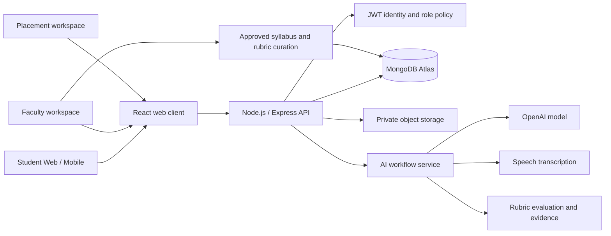

# SpeakSphere Academic Communication Platform

## Product architecture

SpeakSphere combines subject learning with communication practice. The student experience is a specialization-based daily loop: read, learn vocabulary, speak, discuss, review feedback, then adapt the next session to observed needs. Each score should retain its evidence and confidence; do not present a heuristic or missing signal as an AI assessment.

### Proposed system

The existing project is a Vite React client with browser-local progress. There is no Express API, MongoDB, JWT identity, hosted model, transcription service, college role system or cloud document storage connected yet. The AI Academy frontend is an interactive product prototype; it labels those service boundaries instead of claiming they are live.

## Learning workflows

1. **Specialization mentor:** choose a stream and level; select an approved syllabus source; generate a daily reading and speaking prompt tied to source passages and learning outcomes.
2. **Daily path:** 5 minutes reading, 5 vocabulary, 15–20 speaking and 5 discussion. Adapt timing and prompts using consented session evidence, goals and instructor settings.
3. **Communication assessment:** score confidence only from student self-report; score fluency, pronunciation, pace and delivery only when the corresponding signal is available. Assess technical accuracy against approved reference content and show citations/evidence.
4. **Digital twin:** maintain a versioned skill profile from completed sessions. Show trends, uncertainty and a practical estimate range; avoid deterministic placement promises.
5. **Interview / debate / viva:** choose role, specialization, difficulty and rubric. Ask a follow-up grounded in the student's answer. Save transcript, question sequence and rubric evidence.
6. **Research and presentation:** accept a file into private storage, extract text in a protected worker, provide source-linked summary and questions, and let the student practise an explanation. Delete source files according to retention policy.
7. **Readiness analytics:** calculate student-level skill summaries. Show group and college analytics to authorized staff only, with minimum cohort-size protections and no public peer ranking.

## Data model (MongoDB collections)

| Collection | Important fields | Purpose |
|---|---|---|
| `users` | `_id`, `institutionId`, `role`, `email`, `displayName`, `program`, `specialization`, `goals`, `consent`, `createdAt` | Student, faculty, placement and administrator identity/profile |
| `courses` | `_id`, `institutionId`, `program`, `specialization`, `title`, `units`, `outcomes`, `visibility`, `version` | Approved academic structure and source provenance |
| `learningMaterials` | `_id`, `courseId`, `ownerId`, `objectKey`, `mimeType`, `checksum`, `extractedTextRef`, `retentionUntil`, `status` | Protected paper, notes, slide or report metadata |
| `dailyPlans` | `_id`, `userId`, `date`, `goal`, `steps[]`, `sourceRefs[]`, `adaptationReason`, `status` | Personalized reading, vocabulary, speaking and discussion tasks |
| `sessions` | `_id`, `userId`, `kind`, `program`, `topic`, `startedAt`, `endedAt`, `consentSnapshot`, `transcriptRef`, `sourceRefs[]`, `status` | Voice, interview, debate, viva and presentation practice record |
| `assessments` | `_id`, `sessionId`, `rubricVersion`, `metrics[]`, `evidence[]`, `confidence`, `modelVersion`, `createdAt` | Explainable, versioned evaluations; each metric stores evidence and availability |
| `skillProfiles` | `_id`, `userId`, `asOf`, `skills[]`, `trend[]`, `readiness`, `uncertainty`, `nextActions[]` | Digital twin and readiness estimate from completed assessments |
| `interviewRuns` | `_id`, `sessionId`, `role`, `round`, `difficulty`, `turns[]`, `rubricId` | Interview and viva question/follow-up history |
| `debateRooms` | `_id`, `institutionId`, `topic`, `participants[]`, `visibility`, `schedule`, `status` | Moderated peer debate rooms and invitations |
| `auditEvents` | `_id`, `actorId`, `institutionId`, `action`, `resourceType`, `resourceId`, `createdAt` | Access and administrative audit trail |

Index by `{userId, startedAt}`, `{institutionId, program}`, `{courseId, version}` and scoped room schedules. Apply institution scoping and role checks to every query; store only required personal data, encrypt sensitive fields and files, and separate transcript retention from aggregate rubric data.

## API outline

All endpoints use versioned JSON under `/api/v1`, JWT authentication, institution scoping and schema validation. AI endpoints run asynchronously for long tasks and return a job ID.

| Method and path | Access | Purpose |
|---|---|---|
| `GET /me` | Signed-in user | Profile, role and consent status |
| `GET /specializations` | Student, faculty | Allowed programs and specialization list |
| `GET /daily-plan?date=` | Student | Read today's adaptive plan |
| `POST /daily-plan/generate` | Student | Generate plan from approved profile and evidence |
| `POST /sessions` | Student | Create practice session with type and consent snapshot |
| `POST /sessions/:id/turns` | Student | Save answer and request a rubric-grounded follow-up |
| `POST /sessions/:id/complete` | Student | Finalize session and enqueue assessment |
| `GET /sessions/:id/report` | Owner, authorized faculty | Evidence-based scores, feedback and transcript permissions |
| `POST /materials/upload-url` | Student, faculty | Create constrained private upload URL |
| `POST /materials/:id/analyze` | Owner | Extract source content, create summary/question task |
| `GET /profile/skills` | Student; scoped staff aggregate | Skill trends and uncertainty |
| `GET /placement/readiness` | Student; placement role for permitted cohort | Readiness rubric and cohort analytics |
| `GET /faculty/cohorts/:id/progress` | Faculty for assigned cohort | Aggregated progress and skill gaps |
| `POST /debates/rooms` | Student, faculty | Create or join a moderated debate room |
| `DELETE /me/data` | Student | Request account and personal-data deletion |

## Role design

- **Student:** own profile, material, plan, sessions, feedback and deletion controls.
- **Faculty:** assigned course sources/rubrics, cohort-level progress and learner support; no unrestricted private transcript browsing.
- **Placement staff:** authorized placement cohort summaries and mock interview pathways; individual records only where institution policy and student notice permit.
- **Institution administrator:** institution configuration, role assignment, retention policy and audit review; no access to speech content by default.
- **Platform operator:** service reliability and security administration with audited, time-limited support access.

## AI workflow and scoring

Use a retrieval step restricted to approved course material, then generate prompts with source references and a difficulty level. A separate evaluation step receives the student's answer, the prompt, rubric and relevant sources. Return structured dimensions, short evidence spans, actionable feedback, uncertainty and unavailable dimensions. Ask a follow-up only after validating that it is relevant and safe. Speech transcription and acoustic analysis are separate services; transcript text alone cannot establish pronunciation, volume or confidence. Human-authored rubrics and sample answers must be versioned and reviewable. Log model and prompt versions without retaining raw audio unless a separately explained consent and retention policy explicitly allows it.

## Design kit

- **Voice:** encouraging, specific, academically grounded and respectful of different accents; no shame-based streak loss or unsupported promises.
- **Palette:** deep forest ink `#183432`, SpeakSphere teal `#197c73`, soft mint `#f0f8f5`, warm white `#fbfdfc`, muted slate `#75827f`, subtle lilac for reflection states.
- **Type:** Manrope for page and card headings; DM Sans for controls, labels and body copy.
- **Components:** compact uppercase section labels, rounded 12–16 px cards, soft borders, teal primary actions, visible focus states, readable progress indicators, responsive two-column workspace collapsing to one column on mobile.
- **States:** empty, loading, saved, unavailable-signal, error and consent states must be designed explicitly. Always explain what generated a score and where source material came from.

## Mobile and delivery

The current responsive React app can serve as a progressive web interface; a React Native client can reuse the API contract and component tokens. Mobile priorities: one-thumb daily plan, large recording controls, clear countdown/stop states, downloadable approved reading, accessible captions and low-bandwidth upload retry. Add offline drafts only with encrypted local storage and explicit clearing controls.

## Build sequence

1. Connect identity, institution/role authorization and consent management.
2. Create approved course/material ingestion and specialization mentor API.
3. Move session, assessment and skill-profile data from browser storage to the scoped API.
4. Add speech transcription, evidence-backed evaluation and dynamic interview turns.
5. Add protected document processing, debate rooms, faculty and placement analytics.
6. Add mobile client, retention automation, audit review and model-quality monitoring.

Do not present placement probability, technical accuracy or pronunciation as validated until the corresponding data, rubric, evaluation study and authorized service exist.
